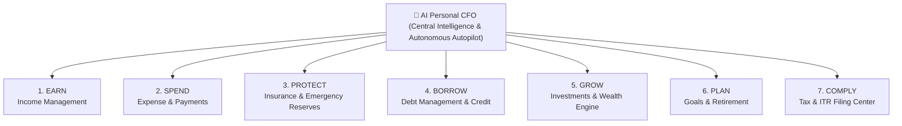

# FINOMOS: Personal Financial Operating System (PFOS) / AI Personal CFO Platform
## Master System Architecture & Functional Requirements Specification (FRD & FRS)

---

### Executive Vision & System Identity
**FINOMOS** is not an expense tracker. It is an enterprise-grade **Personal Financial Operating System (PFOS)** and **Autonomous AI Personal CFO Platform**.

It transforms personal and family finance from reactive bookkeeping into an autonomous, proactive, AI-driven operating system that continuously monitors, advises, prioritizes, automates, and protects financial life across generations.

---

## 1. The 7 Financial Pillars + AI Personal CFO
The entire platform architecture is anchored around **7 Fundamental Financial Pillars**, topped by the central AI intelligence brain:



---

## 2. Master Module Map & Flutter Codebase Mapping

| # | Enterprise Module | Module Code | Primary Purpose | Corresponding Flutter Codebase Path |
|---|-------------------|-------------|-----------------|--------------------------------------|
| **1** | User & Family Management | `UFM` | Multi-member household profiles, PAN/KYC, joint finances | [`lib/features/profile/`](file:///c:/Users/lavan/OneDrive/Desktop/Finomos/lib/features/profile) & [`lib/features/auth_kyc/`](file:///c:/Users/lavan/OneDrive/Desktop/Finomos/lib/features/auth_kyc) |
| **2** | Financial Account Aggregation | `FAA` | AA, Open Banking, Bank, UPI, Card, & Loan syncing | [`lib/features/bank_aggregation/`](file:///c:/Users/lavan/OneDrive/Desktop/Finomos/lib/features/bank_aggregation) |
| **3** | Financial Data Collection Engine | `FDCE` | SMS, Email, OCR receipts, PDF statements, WhatsApp, Voice | [`lib/features/transaction_detection/`](file:///c:/Users/lavan/OneDrive/Desktop/Finomos/lib/features/transaction_detection) |
| **4** | Income Management | `INC` | Multi-stream tracking, forecasting, stability score | [`lib/features/income_tracking/`](file:///c:/Users/lavan/OneDrive/Desktop/Finomos/lib/features/income_tracking) |
| **5** | Expense Management | `EXP` | Categorization, Needs vs Wants, spending behavior | [`lib/features/expense_tracking/`](file:///c:/Users/lavan/OneDrive/Desktop/Finomos/lib/features/expense_tracking) |
| **6** | Subscription Management | `SUB` | OTT, SaaS, renewal alerts, unused detection, auto-pause | [`lib/features/expense_tracking/`](file:///c:/Users/lavan/OneDrive/Desktop/Finomos/lib/features/expense_tracking) / `subscriptions/` |
| **7** | Budget Management | `BDG` | Dynamic AI budgeting, category allocations, shortfall resolution | [`lib/features/budget_management/`](file:///c:/Users/lavan/OneDrive/Desktop/Finomos/lib/features/budget_management) |
| **8** | Cash Flow Management | `CFM` | Real-time liquidity, cash burn, forecasting, runway | [`lib/features/dashboard/`](file:///c:/Users/lavan/OneDrive/Desktop/Finomos/lib/features/dashboard) / `cash_flow/` |
| **9** | Financial Prioritization Engine | `FPE` | P1 (Survive) to P6 (Luxury) allocation & shortfall resolution | [`lib/features/budget_management/`](file:///c:/Users/lavan/OneDrive/Desktop/Finomos/lib/features/budget_management) / `prioritization/` |
| **10** | Payment Management | `PAY` | Unified bill inbox, AutoPay, UPI/NetBanking execution | [`lib/features/bank_aggregation/`](file:///c:/Users/lavan/OneDrive/Desktop/Finomos/lib/features/bank_aggregation) / `payments/` |
| **11** | Financial Autopilot | `FAP` | Autonomous rule builder, salary auto-allocation, guardrails | [`lib/features/cfo_ai/`](file:///c:/Users/lavan/OneDrive/Desktop/Finomos/lib/features/cfo_ai) / `autopilot/` |
| **12** | Emergency Fund Management | `EFM` | Emergency goals, coverage months, crisis runway | [`lib/features/protect/`](file:///c:/Users/lavan/OneDrive/Desktop/Finomos/lib/features/protect) / `emergency_fund/` |
| **13** | Insurance Management | `INS` | Health, Term, Vehicle, gap analysis, claims & renewal | [`lib/features/protect/`](file:///c:/Users/lavan/OneDrive/Desktop/Finomos/lib/features/protect) |
| **14** | Debt Management | `DEBT` | EMI tracking, Snowball/Avalanche, credit health | [`lib/features/borrow/`](file:///c:/Users/lavan/OneDrive/Desktop/Finomos/lib/features/borrow) |
| **15** | Investment Management | `INV` | Mutual funds, stocks, gold, FD, real estate, SIP step-up | [`lib/features/grow/`](file:///c:/Users/lavan/OneDrive/Desktop/Finomos/lib/features/grow) / `investments/` |
| **16** | Wealth Management | `WLM` | Net worth tracking, asset allocation, financial freedom ratio | [`lib/features/grow/`](file:///c:/Users/lavan/OneDrive/Desktop/Finomos/lib/features/grow) / `wealth/` |
| **17** | Goal Management | `GOAL` | Life planning, house, education, retirement, conflict resolver | [`lib/features/plan/`](file:///c:/Users/lavan/OneDrive/Desktop/Finomos/lib/features/plan) / `goals/` |
| **18** | Retirement Planning | `RET` | FIRE calculators, corpus requirements, longevity risks | [`lib/features/plan/`](file:///c:/Users/lavan/OneDrive/Desktop/Finomos/lib/features/plan) / `retirement/` |
| **19** | Tax Management | `TAX` | 365-day tax ledger, Old vs New regime, 80C deductions | [`lib/features/comply/`](file:///c:/Users/lavan/OneDrive/Desktop/Finomos/lib/features/comply) / `tax/` |
| **20** | ITR Preparation Center | `ITR` | One-click filing, Form 16/AIS/TIS import, CA sharing | [`lib/features/comply/`](file:///c:/Users/lavan/OneDrive/Desktop/Finomos/lib/features/comply) / `itr/` |
| **21** | Advisor Ecosystem | `ADV` | CA, CFP, RIA marketplace, secure sharing, dual approval | [`lib/features/advisor_ecosystem/`](file:///c:/Users/lavan/OneDrive/Desktop/Finomos/lib/features/advisor_ecosystem) |
| **22** | AI Personal CFO | `AICFO` | Financial Digital Twin, proactive CFO recommendations | [`lib/features/cfo_ai/`](file:///c:/Users/lavan/OneDrive/Desktop/Finomos/lib/features/cfo_ai) |
| **23** | Financial Health Engine | `FHE` | Holistic 0-100 composite Financial Health Score | [`lib/features/dashboard/`](file:///c:/Users/lavan/OneDrive/Desktop/Finomos/lib/features/dashboard) / `health_score/` |
| **24** | Life Event Planning | `LEP` | Marriage, child birth, home purchase simulations | [`lib/features/plan/`](file:///c:/Users/lavan/OneDrive/Desktop/Finomos/lib/features/plan) / `life_events/` |
| **25** | Financial Risk Engine | `FRE` | Job loss, medical crisis, inflation, crash simulations | [`lib/features/cfo_ai/`](file:///c:/Users/lavan/OneDrive/Desktop/Finomos/lib/features/cfo_ai) / `risk/` |
| **26** | Financial Digital Twin | `FDT` | Complete live virtual financial replica & predictive models | [`lib/features/cfo_ai/`](file:///c:/Users/lavan/OneDrive/Desktop/Finomos/lib/features/cfo_ai) / `digital_twin/` |
| **27** | Reports & Analytics | `REP` | Comprehensive PDF/Excel reports & net worth trends | [`lib/features/analytics/`](file:///c:/Users/lavan/OneDrive/Desktop/Finomos/lib/features/analytics) |
| **28** | Notifications & Alerts | `NOTIF` | Due dates, overspending, risk, and action alerts | [`lib/features/notifications/`](file:///c:/Users/lavan/OneDrive/Desktop/Finomos/lib/features/notifications) |
| **29** | Document Vault | `VAULT` | Encrypted storage for insurance, tax, loan, and property files | [`lib/features/document_vault/`](file:///c:/Users/lavan/OneDrive/Desktop/Finomos/lib/features/document_vault) |
| **30** | Financial Marketplace | `MKT` | Curated insurance, mutual funds, loans, and tax services | [`lib/features/advisor_ecosystem/`](file:///c:/Users/lavan/OneDrive/Desktop/Finomos/lib/features/advisor_ecosystem) / `marketplace/` |
| **31** | Super Admin & FPMS | `FPMS` | 12 Admin governance domains, institution master, audit logs | [`lib/features/fpms_admin/`](file:///c:/Users/lavan/OneDrive/Desktop/Finomos/lib/features/fpms_admin) & [`admin_panel/`](file:///c:/Users/lavan/OneDrive/Desktop/Finomos/lib/features/admin_panel) |

---

## 3. Financial Platform Management System (FPMS - 12 Admin Domains)
1. **Platform Governance (`PGM`)**: Organization setup, financial years, currencies, feature flags, global policies.
2. **User & Household Management**: KYC, verification, household structures, user lifecycle.
3. **Financial Institution Management**: Bank master, AA aggregator registry, UPI/PSP configurations.
4. **Financial Data Engine Administration**: Parser rules (SMS, Email, OCR, PDF), categorization rules.
5. **Master Data Management**: Global taxonomy of income, expenses, merchant database, subscription registry.
6. **Payment Operations**: Biller management, auto-debit rails, payment settlement, failure recovery.
7. **AI & Automation Management**: Prompt library, confidence thresholds, autonomous guardrails, rule weights.
8. **Tax & Compliance Administration**: Tax slabs (Old vs New), regulatory updates, audit trails.
9. **Advisor Ecosystem Management**: Advisor KYC, verification, service fees, rating & reviews.
10. **Marketplace Management**: Product listings, commissions, distribution partners.
11. **Risk, Fraud & Security**: AML monitoring, login anomaly detection, HSM tokenization, data protection.
12. **Analytics & Intelligence**: Executive CXO dashboard (Assets Tracked, Financial Gaps Closed, Net Worth Created).

---

## 4. Priority Sequence & Shortfall Resolution (Core FPE Logic)
```
P1 (SURVIVE): Food, Rent, Utilities, Life-saving Medicines
     ↓
P2 (PROTECT): Health & Term Insurance, Emergency Liquidity Reserve
     ↓
P3 (OBLIGATIONS): EMIs, Credit Cards, Statutory Taxes
     ↓
P4 (GROW): Mandatory SIPs, Retirement, Child Education Goals
     ↓
P5 (ENJOY): Discretionary Dining, Shopping, Travel
     ↓
P6 (LUXURY): Non-essential upgrades, impulse spending, premium luxuries
```

**Shortfall Resolution Algorithm:**
When `Forecast Outflow > Available Inflow`:
1. Preserve P1, P2, and P3 without compromise.
2. Automatically suggest throttling P6 luxury allocations to ₹0.
3. Reduce P5 discretionary budgets.
4. Temporarily pause low-priority discretionary goals (e.g. Vacation goal) with explicit user consent.
5. Prevent loan defaults and maintain credit score integrity.

---

## 5. Security & Compliance Architecture
- **Encryption**: AES-256 at rest, TLS 1.3 in transit.
- **Data Protection**: Account numbers and sensitive IDs masked (e.g., `XXXXXX4587`).
- **Access Control**: Role-based access control (RBAC), multi-factor authentication (MFA).
- **Consent-First Design**: RBI Account Aggregator (AA) compliant consent framework with explicit revocation controls.
- **Audit Logging**: Immutable audit trails for all financial transfers, AI autopilot actions, and governance changes.
